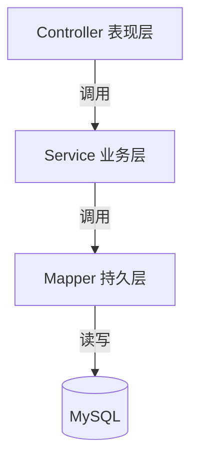
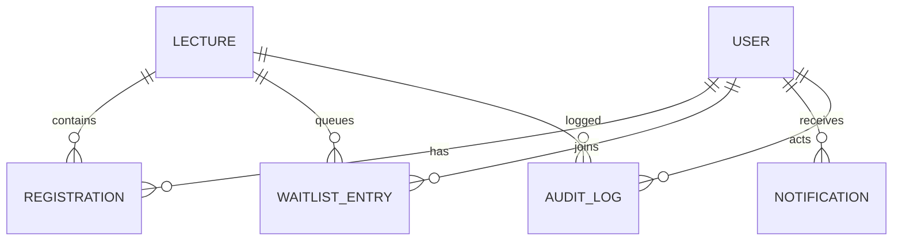

# 架构决策记录（ADR）

本文件记录系统的关键架构决策。每条 ADR 给出**决策**、**被否决的备选方案**、**否决理由**；否决理由必须落在项目的具体约束上（单机部署、无运维、真实规模几十到几百人 / 压测峰值 100 并发、四周工期、Vue + Spring Boot + MyBatis + MySQL、不引入 Redis / 消息队列 / 云服务），不使用「更简单」「更主流」之类的空话。

覆盖六大关键点：名额扣减互斥（ADR-005）、补位触发与幂等（ADR-006）、候补顺序号与缩容插队（ADR-007）、登录与会话（ADR-008）、通知一致性（ADR-009）、部署形态（ADR-010）。

---

## ADR-001 — 前后端分离形态：两个目录，构建期合体、运行态同源

**决策**：前端 Vue 3（Vite）与后端 Spring Boot **各自独立目录、独立构建**——根目录下 `lecture-waitlist-front/` 与 `lecture-waitlist-backend/`。**部署同源**：构建期把 Vue 产物复制进后端 `static/` 静态资源，由后端单端口同时托管前端页面与 `/api`（同一域、零 CORS、**无需 Nginx**）；开发期由 Vite dev server 把 `/api` 代理到后端。

**被否决的备选方案**：

- **前端跨域直连后端（前端 5173 直接调后端 8080）** —— 否决理由：引入 CORS 配置与会话 cookie 的 SameSite / 凭证携带问题，单机 + 无运维下是纯麻烦；同源（后端托管 / Vite 代理）让会话 cookie 天然可用、零 CORS。
- **Nginx 反代托管前端** —— 否决理由：四周工期下，Nginx 只增加部署与配置成本，对本课程考察的并发正确性与补位一致性没有贡献；后端直接托管前端构建产物即可实现同源，无需第三个进程。

**后果**：代码保持 front / back 两个独立工程，构建期合并，运行态单 jar 单端口同源，评审机一条命令即可。

---

## ADR-002 — 后端分层：经典三层架构（Controller / Service / Mapper）

**决策**：后端用经典**三层架构**——Controller（表现层：取参 / 校验 / 返回）→ Service（业务层：业务逻辑 + **事务边界** + 并发锁）→ Mapper（持久层：MyBatis SQL）。依赖只向下。



**被否决的备选方案**：

- **DDD 四层 / 领域模型（domain / service / repository + 聚合）** —— 否决理由：四周工期 + 团队熟悉三层，领域层 / 防腐层对这个「CRUD + 候补状态机」的规模是过度设计；贫血模型足够表达业务。
- **Controller 直接调 Mapper（无 Service 层）** —— 否决理由：事务边界与并发锁会散落在 Controller，无法复用、无法统一审计、无法向评审证明并发正确性。

**后果**：事务与锁集中在 Service，可复用、可评审；Controller / Mapper 各司其职。

---

## ADR-003 — 数据访问：MyBatis + Flyway

**决策**：用 **MyBatis（XML Mapper）** 做持久层，**Flyway** 做版本化迁移；`SELECT … FOR UPDATE` 直接写在 Mapper XML 里；事务边界用 Spring `@Transactional`。

**被否决的备选方案**：

- **Spring Data JPA（Hibernate）** —— 否决理由：团队更熟悉 MyBatis，四周工期里 JPA 的懒加载 / 一级缓存 / N+1 这些隐性行为反而是额外学习与排查成本；且本项目并发 SQL（`FOR UPDATE`）用 MyBatis 的 XML 最直接显式、可评审。
- **MyBatis-Plus** —— 否决理由：团队熟悉的是原生 MyBatis；Plus 的 `BaseMapper` / 条件构造器会隐藏 SQL，与「并发正确性要显式可见」冲突。
- **JdbcTemplate / 裸 JDBC** —— 否决理由：无 `resultMap` / 动态 SQL，样板代码多；MyBatis 的 XML 映射 + 动态 SQL 更省。

**后果**：SQL 显式可见（并发锁一眼能看出），团队零学习成本。

---

## ADR-004 — 状态生命周期与唯一性：硬删除 + 普通 UNIQUE + 审计表留痕

**决策**：**取消报名 / 补位消费 / 退出候补 / 截止清空，一律硬删除对应行**，不保留 `status` 列做软删除；「不双占 / 不双候补」用普通 `UNIQUE(lecture_id, student_id)` 强制；历史留痕由 append-only 的 `audit_log` 表承担。

**被否决的备选方案**：

- **软删除 + 部分唯一索引（`UNIQUE … WHERE status='active'`）** —— 否决理由：**MySQL 不支持部分（过滤）唯一索引**（这是 Postgres 特性），MySQL 下软删除保留行会让普通 UNIQUE 错误阻止「取消后重新报名」。
- **软删除 + 生成列模拟部分唯一（`IF(status='active', student_id, NULL)` STORED + UNIQUE）** —— 否决理由：需要生成列 + 额外约束，四周内难解释、易误用；而硬删除 + 审计表用更简单的结构达到同样的「不双占 + 可审计」。

**后果**：`registration` / `waitlist_entry` 表只存「当前有效」的行，`COUNT(*)` 即有效数，唯一约束天然防双占；任何历史（谁何时报 / 退 / 补 / 清）一律查 `audit_log`。

---

## ADR-005 — 名额扣减的互斥方式：`SELECT … FOR UPDATE` 锁 lecture 行 + 派生计数

**决策**：凡影响某讲座容量 / 报名 / 候补的写事务，**第一步 `SELECT … FOR UPDATE` 锁住该 `lecture` 行**（MyBatis Mapper 写死 `FOR UPDATE`），然后 `COUNT(*)` 派生「有效报名数」与 `capacity` 比较；隔离级别用 MySQL InnoDB 默认的 **REPEATABLE READ**。

**被否决的备选方案**：

- **乐观锁（version 列 + 冲突重试）** —— 否决理由：重试逻辑要在报名 / 取消 / 补位三条路径上都写对，四周内更难证明正确；而 100 并发下悲观锁串行开销完全可以忽略。
- **原子条件扣减（维护 `active_count` 计数列）** —— 否决理由：计数列必须被每条变更路径严格 `+1/-1`，漏改即永久漂移；派生 `COUNT(*)` 永远是事实源，无漂移。
- **SERIALIZABLE 隔离级别** —— 否决理由：引入更多死锁与回滚重试；REPEATABLE READ + `FOR UPDATE`（锁行后读最新已提交）在本场景已经正确，无需为更强隔离买单。

**后果**：并发下「最后一个名额只被一人占用」由行锁串行化 + 唯一约束（ADR-004）双重保证。

---

## ADR-006 — 补位触发机制与幂等：同步触发 + 硬删除原子消费

**决策**：补位**同步触发**——在「取消报名」和「扩容」的**同一个 `@Transactional` 事务内**完成（满足「取消事务提交即完成补位，不依赖后台任务」）。幂等靠「取队首 + **硬删除原子消费**」：`DELETE FROM waitlist_entry WHERE id = :headId` 删掉队首后，再 `INSERT` 一条 `registration(source='promoted')`。行锁串行化下天然不双补；`UNIQUE(lecture_id, student_id)` 兜底。

**被否决的备选方案**：

- **定时扫描（cron / 定时任务）** —— 否决理由：违背「取消事务提交即完成补位，不依赖后台任务」的硬指标——补位必须与取消同事务同步完成，不能用定时任务延迟补位。
- **消息队列 / 事件驱动** —— 否决理由：被约束明确禁止。
- **同步 + 兜底扫描（混合）** —— 否决理由：为单机规模引入第二套补位路径，四周工期里属过度设计。

**后果**：补位与取消 / 扩容同生共死（同事务），天然满足按序、幂等、可审计。

---

## ADR-007 — 候补顺序号生成与缩容插队：复合排序键 + `ROW_NUMBER()` 读时计算

**决策**：候补顺序由**复合排序键 `(cohort, sort_ts)`** 决定，其中 `cohort` 按**数值优先级**比较（`front`→0、`normal`→1），不依赖 `'front' < 'normal'` 的字符串字典序；顺序号是**读时**用 `ROW_NUMBER() OVER (PARTITION BY lecture_id ORDER BY CASE cohort WHEN 'front' THEN 0 ELSE 1 END, sort_ts)` 计算的排名，不落库。`cohort` 取 `front`（缩容移入者，排最前）与 `normal`；正常加入 `sort_ts = joined_at`，缩容移入 `sort_ts = registration.first_entered_at`。

**被否决的备选方案**：

- **物料化 position 整数列** —— 否决理由：插队 / 退队都要重排 position（O(n) 写），并发下还要原子分配 `max+1`，容易漂移；读时 `ROW_NUMBER()` 计算排名无重排、无漂移。
- **`joined_at` 单键排序** —— 否决理由：无法表达「缩容移入者排队首」——缩容移入者的 `joined_at` 晚于现有候补者，按单键会排到队尾，直接违背 FR-12。

**后果**：顺序号 = 队列位置，对学生可见且含义唯一；缩容插队被排序键天然表达，`joined_at` 仅作审计时间戳。

---

## ADR-008 — 登录与会话：Spring Security + 服务端会话 cookie + Spring Session JDBC + BCrypt

**决策**：**Spring Security** 做认证，**服务端会话 cookie**；会话由 **Spring Session JDBC** 存 **MySQL**（不引入 Redis）；密码哈希用 **BCrypt**；角色用单个 `role` 列判别（`student` / `admin` 两值）。会话 cookie 依赖 ADR-001 的同源部署（后端托管 / Vite 代理）保持同一域。

**被否决的备选方案**：

- **无状态 JWT** —— 否决理由：账号由管理员托管，改密 / 禁用需要**立即**生效；无状态 JWT 要撤销就得回黑名单（又变回服务端状态）或等过期。本项目可控性优先于无状态扩展性。
- **进程内存 session** —— 否决理由：重启即丢会话；单机但进程会重启，与「不懂运维的助教」体验冲突。
- **Redis 存 session** —— 否决理由：被约束明确禁止。
- **OAuth / 第三方登录** —— 否决理由：约束禁止云服务 / 外部依赖，且产品无自助注册，学号 + 密码是唯一入口。

**后果**：会话、禁用、改密即时可控；会话落在 MySQL，不引入 Redis。

---

## ADR-009 — 站内通知与业务事务的一致性：同事务写库

**决策**：站内通知就是本库 `notification` 表的一行数据，**与产生它的业务变更（补位 / 被移出 / 候补清空）写在同一个 `@Transactional` 事务里**，业务回滚则通知一并回滚。

**被否决的备选方案**：

- **Outbox + 异步投递** —— 否决理由：outbox / 异步 worker 是为投递到外部系统（邮件 / 短信 / 推送）设计的；本项目通知只有站内 DB 行，无外部投递目标，引入 outbox 是多余复杂度，且需后台进程，与「单机一条命令」冲突。
- **消息队列 / 事件总线** —— 否决理由：被约束明确禁止。

**后果**：通知与业务强一致，审计链完整，零外部依赖。

---

## ADR-010 — 部署形态：单 jar 同源 + Docker Compose 两容器

**决策**：构建期把 Vue 产物复制进后端 `static/`，后端打包成**一个可执行 jar**（同源托管前端 + `/api`，无需 Nginx）；**Docker Compose 两容器**（`backend` + `mysql`）一条命令 `docker compose up -d --build` 起服务（含 Flyway 迁移 / 初始化管理员）；开发期 Vite dev server 代理 `/api`。另提供 `scripts/bootstrap.sh` 作为无 Docker 环境回退。

**被否决的备选方案**：

- **Nginx 反代（三容器）** —— 否决理由：四周工期下，Nginx 只增加部署与配置成本，对本课程考察的并发正确性与补位一致性没有贡献；后端直接托管前端构建产物即可实现同源，无需第三个进程。
- **裸 `java -jar` + 手动建库 / 迁移 / 初始化** —— 否决理由：违背「评审机一条命令起服务」，把建库 / 迁移 / 初始化的手工步骤丢给不懂运维的助教。
- **云托管 / 远程数据库** —— 否决理由：被约束明确禁止（任何云服务），且是单机内网场景。

**后果**：`README` 只给一条命令，运维门槛最低，符合「管理员是不懂运维的学生助教」。

---

## ADR-011 — 时间触发的流转：读时派生状态 + 进程内定时清空候补

**决策**：讲座状态（已发布 / 已开始 / 已结束）**读时按当前时间对 `start_at`/`end_at` 派生**，不落状态列；「报名截止自动清空候补」由**进程内定时任务**执行——Spring `@Scheduled`（`fixedDelay = 60s`），随应用启动、跑在同一 JVM 内，不是独立进程，一条命令起服务即自带；每轮扫描 `now > reg_deadline` 且仍有候补行的讲座，在事务内 `DELETE` 清空候补并写通知，重复执行因已无行而无副作用（幂等）。

**被否决的备选方案**：

- **惰性清空（触及该讲座的读写事务内顺带清空）** —— 否决理由：依赖访问触发、无人访问则永不清空；停机期间到期不生效；把写副作用藏在只读接口里、与「只读请求不加事务」语义冲突；通知延迟到下一次访问才产生。
- **持久化状态列 + 定时翻转** —— 否决理由：需要 worker 在起止时刻翻状态，状态本就是时间的纯函数，派生无漂移。

**后果**：状态流转零后台依赖；候补清空由单进程内定时任务保证「报名截止后 1 分钟内清空并通知」（SM-4），评审机一条命令起服务即可。

---

## 工程结构与数据模型

### 目录布局（前后端分离）

```text
lecture-waitlist/               # 仓库根目录
├── lecture-waitlist-front/     # Vue 3 + Vite + TypeScript（独立工程）
├── lecture-waitlist-backend/   # Spring Boot + MyBatis + MySQL（独立工程）
├── docker-compose.yml          # backend + mysql
└── scripts/bootstrap.sh         # 无 Docker 回退
```

### 数据模型（配合 ADR-004 硬删除语义）



| 实体 | 关键字段 | 约束 / 语义 |
| --- | --- | --- |
| `user` | `username`(学号)、`password_hash`、`role`、`name` | `username` 唯一；`role` ∈ {student, admin} |
| `lecture` | `title`、`start_at`/`end_at`、`capacity`、`reg_open_at`(可空)、`reg_deadline`、`created_at`、可选地点/主讲人/类型 | 无 `status` 列（读时派生）；`created_at` = 发布时间（FR-12 容量窗口起点）；`reg_deadline` = 由 `start_at` 减 30 分钟在发布时计算并写入，非管理员输入 |
| `registration` | `lecture_id`、`student_id`、`source`(direct/promoted)、`registered_at`、`first_entered_at`(NOT NULL) | `UNIQUE(lecture_id, student_id)`；取消即删行；`first_entered_at` = 本次报名生命周期内首次进入该讲座队列的时间（直接报名 = `registered_at`；补位 = 被消费候补行的 `sort_ts`） |
| `waitlist_entry` | `lecture_id`、`student_id`、`cohort`(front/normal)、`sort_ts`、`joined_at` | `UNIQUE(lecture_id, student_id)`；补位/退出/清空即删行 |
| `notification` | `user_id`、`text`、`is_read`、`created_at` | 同事务写入 |
| `audit_log` | `actor_id`、`actor_type`(system/user)、`lecture_id`、`action`、`seq`、`cohort`、`sort_ts`、`before`/`after`、`created_at` | append-only，历史唯一来源；硬删除后靠 `seq`/`cohort`/`sort_ts` 还原候补队列（`sort_ts` 仅用于审计还原，不参与业务排序） |
